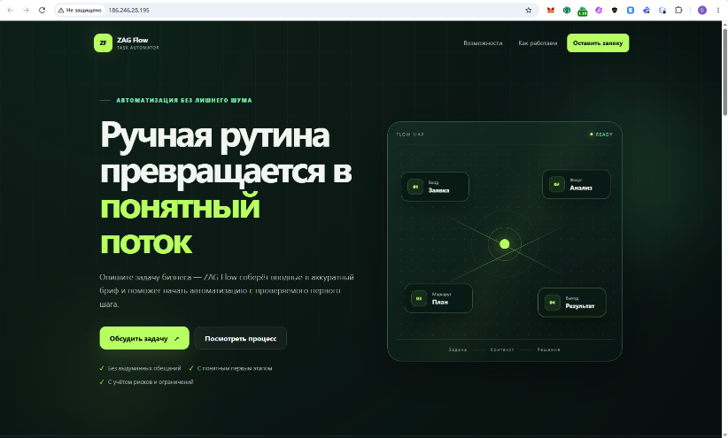
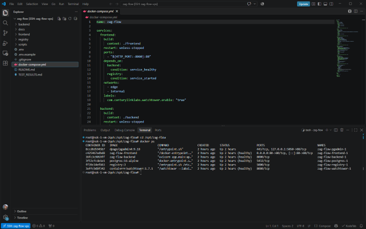
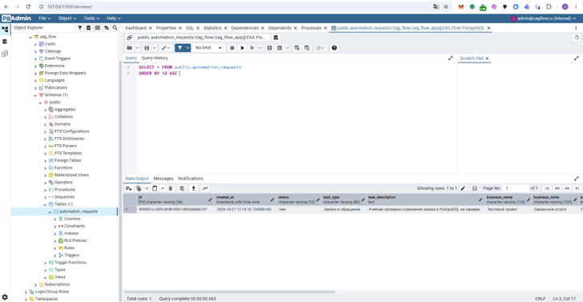
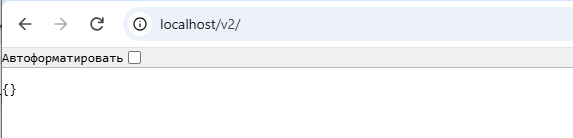
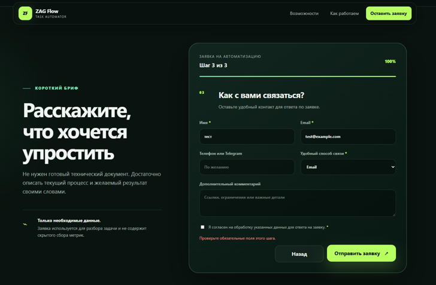

# ZAG Flow

ZAG Flow — адаптивный сервис для приёма и первичной структуризации заявок на автоматизацию. Посетитель описывает текущий процесс, ожидаемый результат, бюджет и удобный способ связи, а Backend проверяет данные и сохраняет заявку в PostgreSQL.



Проект развёрнут на VPS с Ubuntu 24.04 в едином Docker Compose-контуре. Подробные шаги собраны в [инструкции по развёртыванию](docs/DEPLOYMENT_UBUNTU_24_04.md), фактические локальные и серверные проверки — в [TEST_RESULTS.md](TEST_RESULTS.md).

## Что реализовано

- адаптивный лендинг с доступной навигацией и анимациями;
- пошаговый бриф из трёх этапов;
- проверка обязательных полей в браузере и на Backend;
- явное согласие на обработку данных: галочка обязательна и не установлена заранее;
- сохранение заявок в PostgreSQL;
- безопасная выдача технического статуса без контактных данных;
- health-check сайта, API и базы данных;
- Nginx как единственная публичная точка входа;
- pgAdmin только через localhost и SSH-туннель;
- локальный Docker Registry с `bcrypt`-авторизацией;
- Watchtower в режиме наблюдения без автоматической замены критических контейнеров.

## Архитектура

```text
Посетитель -> Nginx -> статический Frontend
                    -> /api -> FastAPI -> PostgreSQL

Разработчик -> Nginx -> /v2/ -> Docker Registry
Администратор -> SSH-туннель -> pgAdmin -> PostgreSQL
```

Backend, PostgreSQL и Registry работают только во внутренней Docker-сети. Наружу опубликован Nginx; порт pgAdmin привязан к `127.0.0.1` сервера и открывается через SSH-туннель.

## Стек

- HTML, CSS, JavaScript;
- FastAPI, Pydantic, SQLAlchemy;
- PostgreSQL 16;
- Nginx;
- Docker Compose;
- pgAdmin;
- CNCF Distribution Registry;
- Watchtower.

## Проверено на VPS

На сервере одновременно запущены шесть контейнеров: Frontend, Backend, PostgreSQL, pgAdmin, Registry и Watchtower. Контейнеры не уходят в цикл перезапуска; сервисы с health-check имеют статус `healthy`.



Тестовая заявка с вымышленными данными прошла через публичную форму и API и была подтверждена прямым просмотром таблицы `automation_requests` в PostgreSQL.



Registry закрыт отдельной авторизацией. После входа через SSH-туннель endpoint `/v2/` возвращает штатный ответ `{}`.



## Согласие и границы обработки данных

Пользователь должен самостоятельно поставить обязательную галочку согласия. По умолчанию она пустая; без неё браузер не отправляет форму, а Backend принимает только значение `true`.



Текущая версия предназначена для учебного запуска и демонстрации на вымышленных данных. Сознательно отложены до отдельного этапа коммерческой подготовки:

- формальный срок хранения заявок;
- регламент автоматического и ручного удаления;
- отдельная политика обработки персональных данных;
- домен, TLS-сертификат и обязательный HTTPS;
- проверка организационных требований к работе с реальными персональными данными.

До реализации этих пунктов публичная форма не используется для реальных ФИО, телефонов, email и других персональных данных.

## Локальный запуск

### 1. Подготовить настройки

```powershell
Copy-Item .env.example .env
```

Замените демонстрационные значения в `.env`. Пароли PostgreSQL, pgAdmin и Registry должны быть разными.

### 2. Создать пользователя Registry

В Windows PowerShell:

```powershell
.\registry\create-user.ps1
```

На Ubuntu:

```bash
chmod +x registry/create-user.sh
./registry/create-user.sh
```

### 3. Проверить и запустить инфраструктуру

```powershell
.\scripts\check-project.ps1
docker compose up -d --build
docker compose ps
```

По умолчанию сайт доступен по адресу `http://localhost:8080`, документация API — `http://localhost:8080/api/docs`, pgAdmin — `http://127.0.0.1:5050`.

### 4. Остановить проект

```powershell
docker compose down
```

Именованные тома сохраняются. Команда `docker compose down -v` удаляет данные и для обычной остановки не используется.

## Проверка API без Docker

```powershell
python -m venv .venv
.\.venv\Scripts\python.exe -m pip install -r backend\requirements-dev.txt
$env:PYTHONPATH = "backend"
.\.venv\Scripts\python.exe -m pytest backend\tests -q
```

## Переменные окружения

| Переменная | Назначение |
|---|---|
| `HTTP_PORT` | публичный порт Nginx |
| `POSTGRES_DB` | имя базы данных |
| `POSTGRES_USER` | пользователь приложения |
| `POSTGRES_PASSWORD` | отдельный пароль PostgreSQL |
| `PGADMIN_HOST_PORT` | localhost-порт pgAdmin |
| `PGADMIN_DEFAULT_EMAIL` | учётная запись pgAdmin |
| `PGADMIN_DEFAULT_PASSWORD` | отдельный пароль pgAdmin |
| `REGISTRY_USER` | имя пользователя Registry |
| `REGISTRY_HTTP_SECRET` | внутренний случайный секрет Registry |

## Безопасность

- `.env` и `registry/auth/htpasswd` исключены из Git;
- базы, кэши и логи исключены из Git;
- SSH-доступ к VPS настроен по ключу;
- firewall разрешает входящие подключения только к SSH и учебному HTTP;
- PostgreSQL и Backend не публикуют порты на хосте;
- pgAdmin используется через SSH-туннель;
- Registry имеет отдельную авторизацию и до появления HTTPS проверяется через SSH-туннель;
- каждый серверный пароль и внутренний секрет сгенерирован отдельно;
- Watchtower не обновляет PostgreSQL, pgAdmin и Registry;
- форма не собирает скрытые маркетинговые метрики и технический отпечаток устройства.

## Статус

Первая часть MVP завершена и развёрнута на учебном VPS. Панель администратора приложения, AI-обработка заявок и дополнительные интеграции относятся к следующим этапам.
