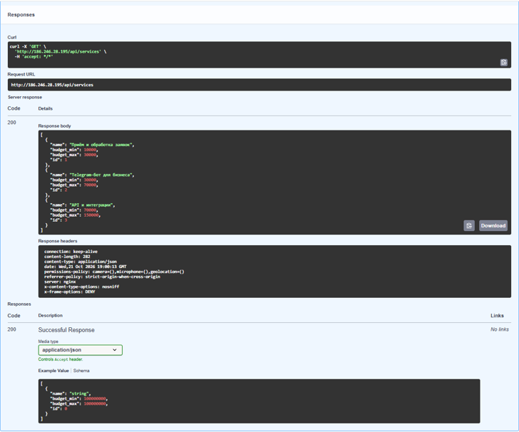
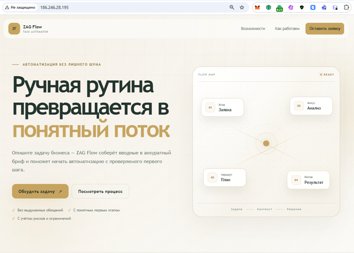
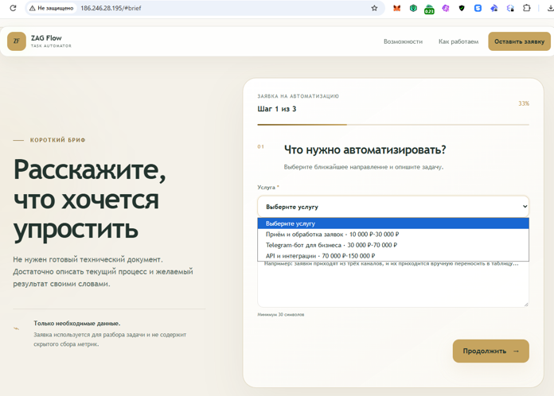
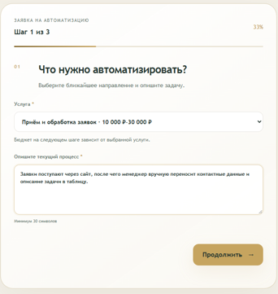
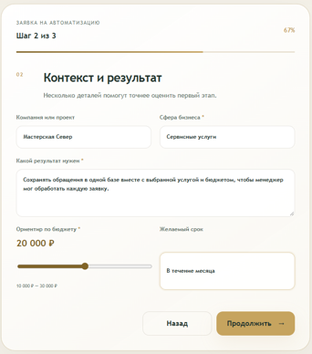
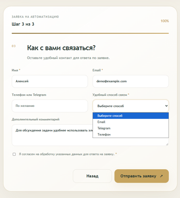
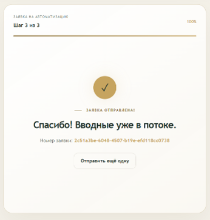
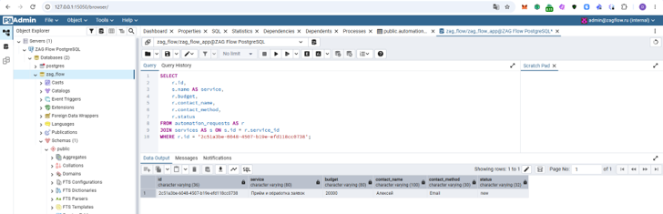

# ZAG Flow

Разработал сервис для приёма заявок на автоматизацию. Проверил загрузку каталога услуг, выбор бюджета, заполнение формы и сохранение заявки в PostgreSQL. Для демонстрации использовал вымышленные данные.

Сайт: http://186.246.28.195/
Репозиторий: https://github.com/Denis-Zag/ZAG-Flow

## 1. Каталог услуг через API

В Swagger выполнил GET-запрос к `/api/services`. Сервер вернул код 200 и три услуги с разными диапазонами бюджета. Этот каталог используется для заполнения списка на сайте.

## 2. Главная страница

Оформил главную страницу в светлой цветовой гамме с золотистыми акцентами. На ней показаны назначение сервиса, схема обработки заявки и кнопка перехода к форме.

## 3. Раскрытый список услуг

Показал раскрытый список со всеми тремя услугами и диапазонами бюджета. Пункты загружаются через API из PostgreSQL, поэтому форма использует тот же каталог, который возвращает Backend.

## 4. Выбор услуги и описание задачи

Выбрал услугу «Приём и обработка заявок» и описал текущий процесс: обращения с сайта вручную переносятся в таблицу. На первом шаге форма собирает направление работы и исходную задачу клиента.

## 5. Контекст и бюджет

Указал компанию «Мастерская Север», сферу бизнеса, ожидаемый результат и желаемый срок. Установил бюджет 20 000 ₽ ползунком в диапазоне 10 000–30 000 ₽, соответствующем выбранной услуге.

## 6. Контакты и способы связи

Заполнил имя и вымышленный Email, показал раскрытый список способов связи: Email, Telegram и телефон. Для отправки заявки выбрал Email. Это значение сохраняется как пожелание клиента для последующей связи.

## 7. Подтверждение отправки

После заполнения формы и подтверждения согласия получил сообщение «Заявка отправлена!» и уникальный номер `2c51a3be-6048-4507-b19e-efd118cc0738`. Этот номер использовал для проверки записи в базе.

## 8. Сохранённая заявка в PostgreSQL

В pgAdmin выполнил SQL-запрос по номеру отправленной заявки. В результате получил одну строку с услугой «Приём и обработка заявок», бюджетом 20000, именем Алексей, способом связи Email и статусом new. Данные в базе совпали с введёнными в форме.

## Дополнительные проверки

Выполнил сборку фронтенда командой `npm run build` и проверил загрузку CSS и JavaScript с кодом 200. Backend и PostgreSQL работают в Docker Compose; health-check подтверждает подключение к базе. В логе Backend отправка заявки подтверждена ответом 201 Created.

Проверил обязательное согласие: без галочки форма остаётся открытой и показывает сообщение об обязательных полях. После подтверждения согласия заявка отправляется. Повторный запуск автоматических проверок завершился успешно: 10 тестов пройдены.

Демонстрация работает по HTTP с вымышленными данными. Способ связи сохраняется в заявке; отправка сообщений и писем автоматически не выполняется.