# ZAG Flow: панель управления и аналитика

Проверка от 22 октября 2026 года. Для заявок использованы вымышленные данные.
Онлайн-демонстрация отключена 22 октября 2026 года: VPS и публичный IP удалены.
Адреса ниже относятся только к проверке и не являются действующими ссылками на приложение.
[Статус демонстрации](DEMO_STATUS.md).

[Сайт](https://186.246.28.195/next/) · [Панель управления](https://186.246.28.195/next/admin.html) · [Документация API](https://186.246.28.195/next/api/docs)

## Вход и защита доступа

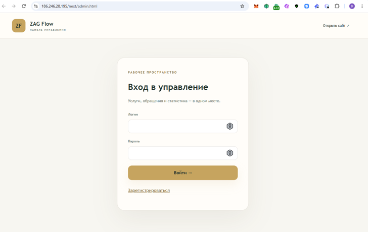

До создания первого администратора доступна первичная регистрация с ключом настройки.

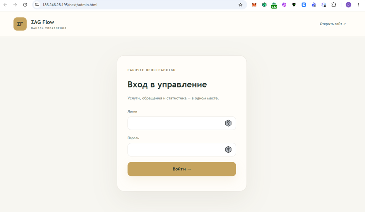

После регистрации и выхода предложение зарегистрироваться исчезло. Повторное создание администратора также запрещено на уровне API.

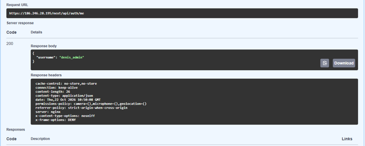

Авторизованный запрос `/next/api/auth/me` вернул код 200 и профиль `denis_admin`. Токен в кадре не показан.

## Создание и изменение услуг

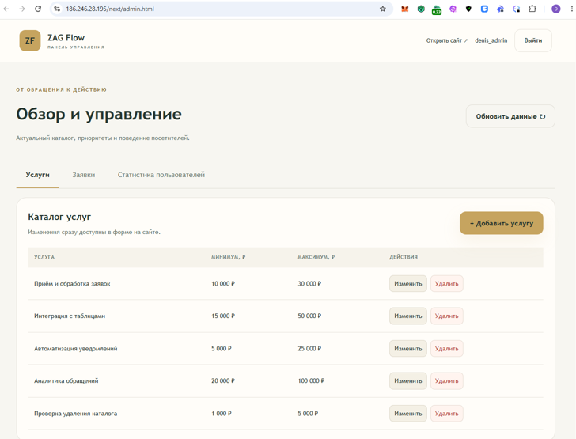

Через панель создал пять услуг с диапазонами бюджета.

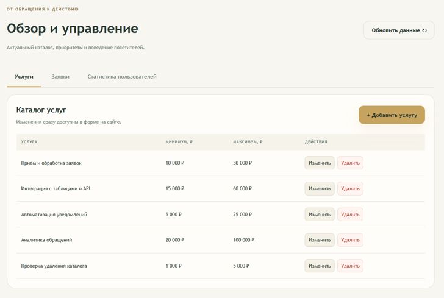

Услугу переименовал в «Интеграция с таблицами и API», верхнюю границу бюджета изменил на 60 000 ₽.

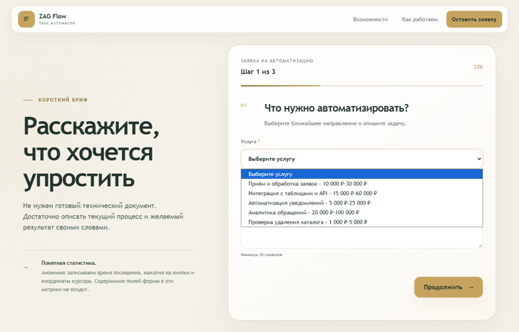

После обновления страницы форма получила актуальные названия и цены из API, включая созданную услугу «Проверка удаления каталога».

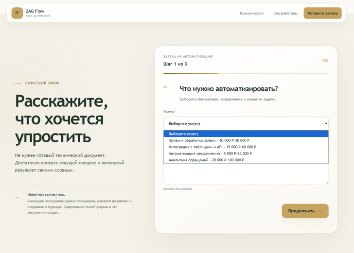

Удалил эту свободную услугу через панель. После обновления формы в каталоге осталось четыре пункта. Услуги, связанные с сохранёнными заявками, защищены от удаления.

## Статистика посещений

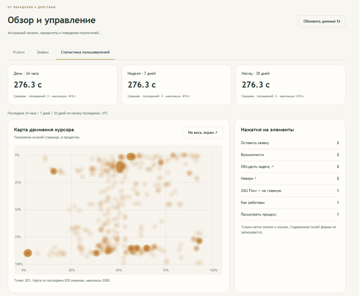

На момент проверки панель показала три посещения, среднее время 276,3 секунды и максимум 418 секунд. Значения за сутки, неделю и месяц совпадают, поскольку посещения попали во все три периода. Справа отображаются накопленные нажатия на элементы сайта.

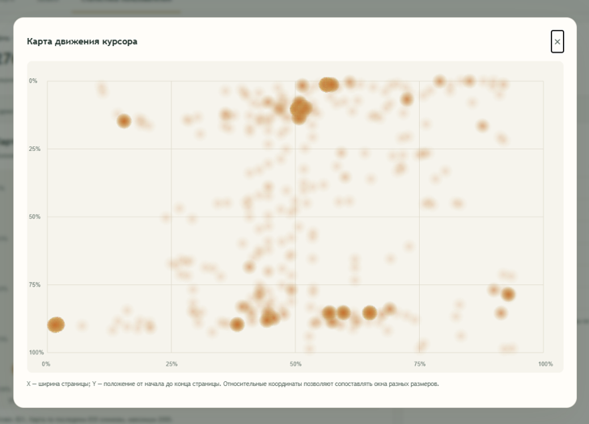

Открыл карту на весь экран. Координаты нормализованы относительно ширины и полной высоты страницы. В обзорном кадре карта содержала 821 точку по последним 830 снимкам; выборка ограничена 2 000 записями.

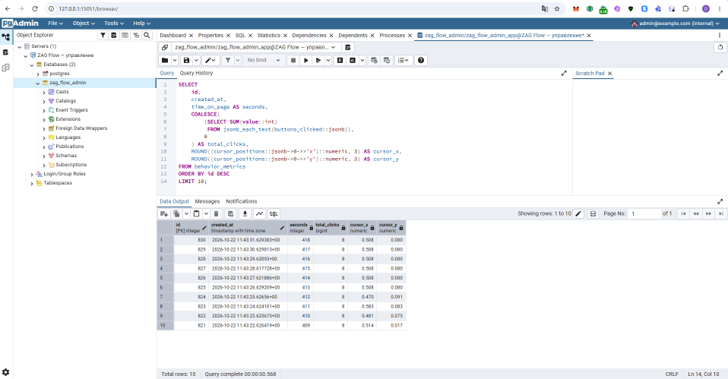

В pgAdmin выполнил запрос к `behavior_metrics`. Последние десять строк показывают время от 409 до 418 секунд, накопленный счётчик восьми кликов и координаты курсора. Это последовательные снимки одного посещения: счётчики кликов между строками не суммируются. Содержимое полей формы в метрики не записывается.

## Очередь и приоритеты заявок

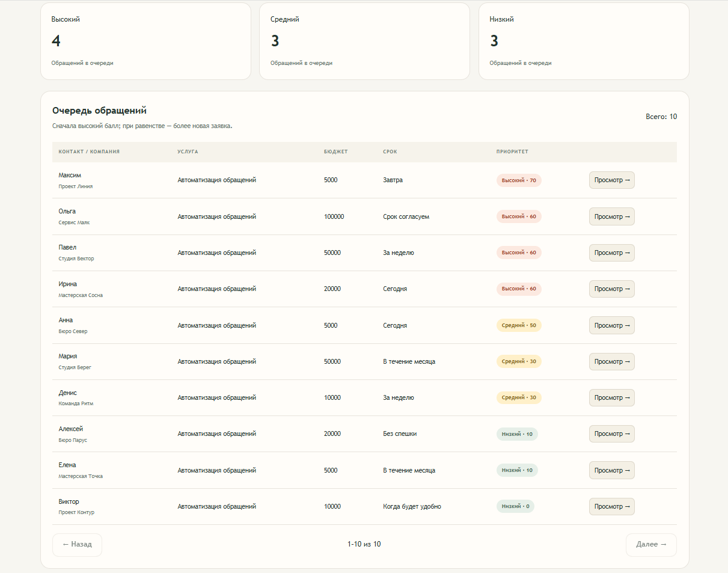

Загрузил десять демонстрационных заявок: четыре высокого, три среднего и три низкого приоритета. Очередь отсортирована по убыванию баллов; при равных баллах выше более новая заявка. Технический статус `new` не определяет категорию приоритета.

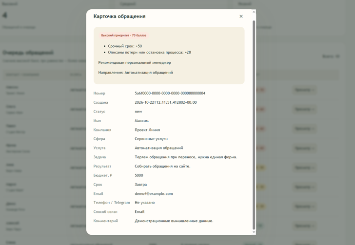

Карточка Максима получила 70 баллов: 50 за срочный срок и 20 за описанные потери обращений. Панель показывает причины оценки и рекомендацию персонального менеджера.

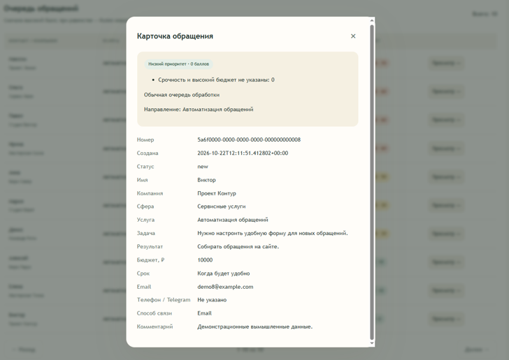

Карточка Виктора получила 0 баллов: срочность и высокий бюджет не указаны, дополнительных признаков для повышения оценки нет. Показана обычная очередь обработки. [Формула и ограничения оценки](PRIORITY_RULES.md).

## Состояние приложения после проверки

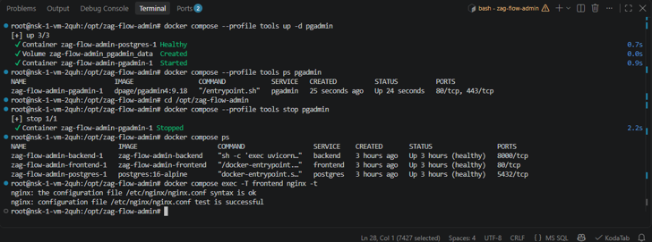

После работы с базой остановил вспомогательный pgAdmin. Основные контейнеры Frontend, Backend и PostgreSQL остались в состоянии `healthy`; проверка конфигурации Nginx завершилась успешно. В отдельно просмотренных последних 30 строках журнала Backend все запросы завершились с кодом 200, включая вход, профиль, список и карточки заявок.

## HTTPS

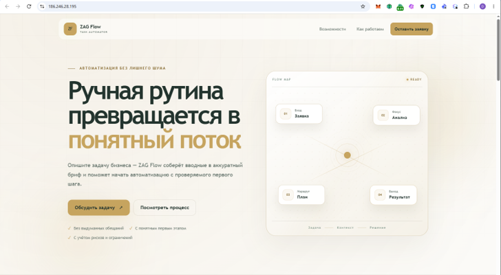

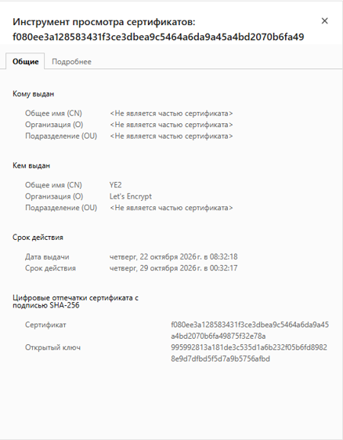

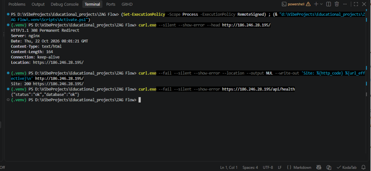

Браузер подтвердил защищённое подключение и действительный сертификат Let's Encrypt. HTTP перенаправляет на HTTPS с кодом 308, конечная страница отвечает 200, проверка API возвращает `status=ok` и `database=ok`.

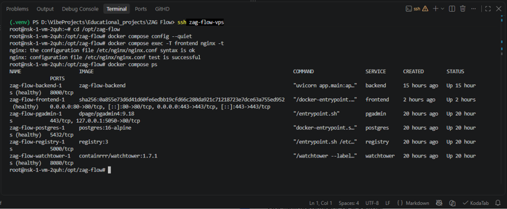

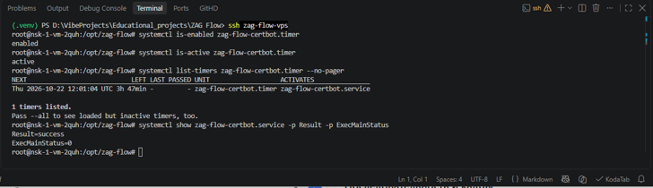

Проверка Nginx успешна. Таймер продления сертификата включён и активен; у службы результат `success` и код завершения 0.

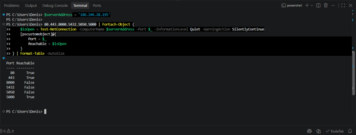

С компьютера без VPN порты 80 и 443 доступны, 8000, 5432 и 5050 недоступны. Для порта 5000 эта проверка дала `True`, поэтому кадр не подтверждает закрытие этого порта. Дополнительная проверка конфигурации сервера и независимые внешние проверки описаны в [отчёте HTTPS](HTTPS_DEPLOYMENT.md).

## Дополнительные материалы

- [Результаты автоматических и ручных проверок](ADMIN_RESULTS.md)
- [Демонстрация сохранённой версии 0.2.0](DEMONSTRATION_0_2.md)

При проверке сохранённая версия 0.2.0 была доступна отдельно по корневому адресу сайта. Новая версия использовала префикс `/next/`, отдельные контейнеры и базу данных.
